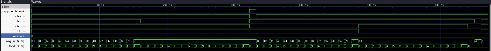
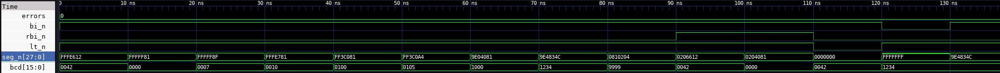

# VHDL Seven-Segment Driver

A BCD to seven-segment decoder written in VHDL after the SN74LS247 chip, and a four-digit display driver built
from four copies of it. I wrote it to practise VHDL beyond the small exercises of a course, and to see how separate
blocks are described on their own and then wired together in a top-level design. Everything is checked with
self-checking testbenches in GHDL. It has only been simulated and has not been run on an FPGA.

## Repository structure

```
rtl/
  ls247.vhd          single-digit decoder, behaves like the SN74LS247
  display4.vhd       four ls247 instances chained for leading zero blanking
tb/
  seg_pkg.vhd        segment table and helper functions shared by the testbenches
  tb_ls247.vhd       testbench for ls247
  tb_display4.vhd    testbench for display4
course/
  mux_4x1.vhd        4-to-1 multiplexer from a course exercise
  tb_mux_4x1.vhd     exhaustive testbench for it
docs/images/         waveform screenshots from GTKWave
Makefile
```

## The ls247 decoder

The decoder follows function table T1 of the Texas Instruments datasheet (document SDLS083). It takes a 4-bit code
on `bcd` and drives seven active-low outputs `seg_n`, where `0` lights a segment. Codes 0 to 9 show the digits
with the tails on 6 and 9 that the LS247 has and the older LS47 does not. Codes 10 to 14 show the special symbols
from the datasheet and 15 is blank.

| Input | Function |
|---|---|
| `bi_n` low | blanks the digit whatever the other inputs are |
| `lt_n` low | lamp test, lights all seven segments |
| `rbi_n` low | blanks the digit if the code is 0, and pulls `rbo_n` low |

The priority is the one given in the notes of table T1. BI wins over the lamp test, and the lamp test wins over
ripple blanking.

On the real chip BI and RBO share one pin that works as an input and as an open-collector output at the same time.
An FPGA pin cannot do that inside the logic, so the model splits it into the input `bi_n` and the output `rbo_n`.

## The display4 driver

`display4` has no logic of its own. It creates four `ls247` instances with a `for ... generate` loop and connects
the `rbo_n` of each digit to the `rbi_n` of the digit on its right. A digit is blanked only when it is zero and
every digit to its left is blank too, so `0042` is shown as `  42` and `0105` as ` 105`. The units digit has its
`rbi_n` tied high so that a value of zero still shows one `0`. The external `rbi_n` input switches leading zero
blanking on (low) or off (high), and `lt_n` and `bi_n` go to all four digits.

The four BCD digits come in on `bcd(15 downto 0)` with the leftmost digit in the top four bits. The outputs are
`seg_n(27 downto 0)`, seven bits per digit in the same order.

## Course exercise

`course/mux_4x1.vhd` is a 4-to-1 multiplexer I wrote while learning VHDL in ELM4070 Microcontroller Based System Design
at Yildiz Technical University (YTU). It is kept as written, apart from a header comment. The testbench next to it was added later and tries all 64
combinations of the data and select inputs.

## Requirements

- GHDL, tested with GHDL 6.0.0
- GTKWave, only for looking at the waveforms
- make

The testbenches use VHDL-2008. I ran everything in Kali Linux on an Android phone, with GTKWave on an XFCE desktop
over VNC.

## Usage

```
make test                   # analyze, elaborate and run all testbenches
make wave                   # run the tests and open the display4 waveform in GTKWave
make wave WAVE=tb_ls247     # open another waveform
make clean
```

Output of `make test`

```
tb/tb_ls247.vhd:90:13:@670ns:(report note): ls247: all checks passed
tb/tb_display4.vhd:124:13:@140ns:(report note): display4: all checks passed
course/tb_mux_4x1.vhd:42:13:@640ns:(report note): mux_4x1: all checks passed
```

## Testing

The testbenches compare every output with an expected value and report each mismatch, so a passing run needs
no checking by eye.

- `tb_ls247` makes 66 checks. These are the 16 codes in normal mode, BI low for every code, RBI low with 0 and with
  every other code, the lamp test for every code and the two priority cases.
- `tb_display4` makes 13 checks of the four-digit display with blanking on and off, the lamp test and BI.
- `tb_mux_4x1` checks all 64 input combinations.

The expected segments are written as letters, for example `"acdefg "` for 6, instead of being copied from the
decoder as bit vectors. To make sure the testbenches can fail, I broke each design on purpose in a scratch copy.
I removed the tail of the 6, connected the tens digit of `display4` to the wrong ripple signal and swapped two mux
inputs. Each testbench reported the error.

## Results

The ls247 testbench in GTKWave. `bcd` counts from 0 to F in normal mode, then with BI low, RBI low and the lamp
test. `seg_n` is shown in hex, so `01` is the digit 0 with only segment g off and `7F` is a blank digit.



The display4 testbench. Each `seg_n[27:0]` value holds the four digits, for example `FFFE612` for input `0042`
is two blank digits followed by 4 and 2.



## Limitations

- Only simulated. The design has not been synthesized or tried on an FPGA board.
- `display4` drives all 28 segment lines at once, which needs 28 output pins. Real multi-digit displays are usually
  multiplexed so that one decoder serves all digits in turn.
- The outputs are plain logic levels. The chip's open-collector outputs that sink current from the LEDs are not modelled,
  and neither are propagation delays.

## Possible improvements

- A multiplexed version that switches one decoder between the four digits with a counter, which is also where the
  multiplexer would find a use
- A binary to BCD converter in front of `display4`
- Running it on an FPGA board with a real display
